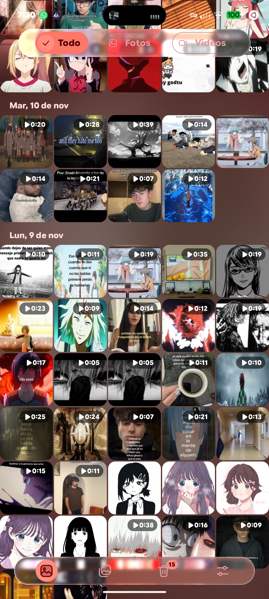
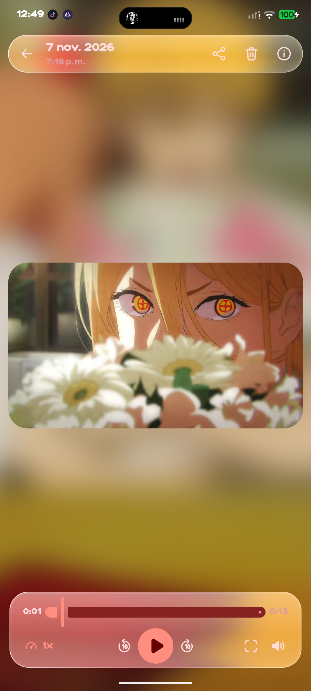
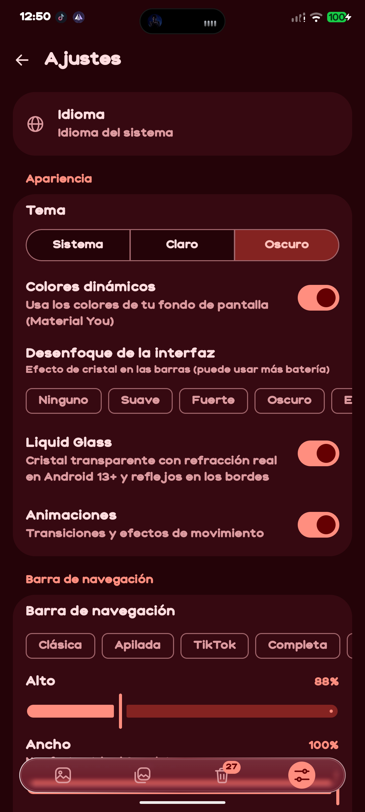
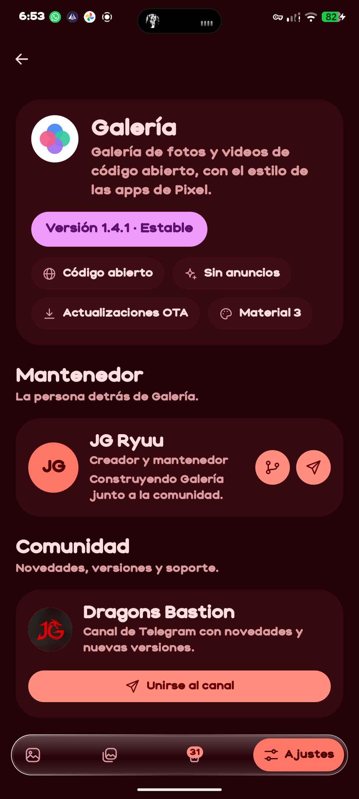

<p align="center">
  
</p>

# Pixel Gallery You 🖼️

<p align="center">
  <b>An open-source photo and video gallery for Android</b><br>
  Styled after native Pixel apps, built with Jetpack Compose and Material Design 3
</p>

<p align="center">
  
  
  
  
</p>

<p align="center">
  <a href="https://github.com/JGRyuuTB/Pixel-Gallery/releases/latest"></a>
  <a href="https://github.com/JGRyuuTB/Pixel-Gallery/releases"></a>
  
  
  
</p>

---

## ✨ Features

### 🎨 Modern UI/UX

- **Material You**: dynamic colors that adapt to your wallpaper.
- **Floating glass navigation bar** with 7 styles to choose from in Settings: Classic, Stacked, TikTok, Full, Island, Indicator and Bubble. Badge with the number of items in the trash. Size, width, bottom distance, icon size and roundness can be calibrated in Settings.
- **7 blur types** for the glass: Soft, Strong, Dark, Frosted, Vivid, Smoke and Acrylic (or none).
- **Liquid Glass**: transparent glass with real refraction on Android 13+ and edge highlights.
- **Smooth animations**: the viewer grows from the thumbnail and returns to it, albums and menus slide in and out. You can turn them off.
- **Light, dark or system theme.**
- **Rounded corners** on thumbnails and a customizable border on the player panel.
- **Player controls**: choose between the default panel attached to the bottom or a floating one.
- **Material You app icon** that picks up your wallpaper colors (or the default icon).
- **Predictive back** gesture support.
- **In-app (OTA) updates** from GitHub Releases.
- **Languages**: Spanish, English, Portuguese, French, German, Italian, Russian, Japanese and Simplified Chinese, switchable in Settings > Language.

### 📷 Photos & Albums

- **Fluid grid** with thumbnail preloading.
- **Pinch to zoom the grid** and change the number of columns (2 to 5).
- **Separate column settings** for Photos and Albums.
- **Configurable thumbnail spacing**: None, Small or Large.
- **Albums**, with the option to move photos between them.

### 🔍 Viewer

- **Zoom** on photos.
- **Built-in video player**: playback speed, 10-second skips, volume and a progress bar.
- **Play on open**: videos can start automatically.
- **Swipe down** to close a photo or video.
- Quick actions: share, delete and view details.

### 🗑️ Trash

- Delete with the option to restore later.
- Permanent deletion and empty trash.
- Requires Android 11 or higher.

### 🔒 Privacy

- **No ads.**
- **No trackers.**
- **Internet is used only for** in-app updates, your GitHub profile photo and the Telegram channel logo in the About screen.

---

## 🛠️ Tech Stack

| Category | Technology |
|---|---|
| **Language** | [Kotlin](https://kotlinlang.org/) 100% |
| **UI Framework** | [Jetpack Compose](https://developer.android.com/jetpack/compose) |
| **Design System** | [Material Design 3](https://m3.material.io/) |
| **Video Player** | [Media3 ExoPlayer](https://developer.android.com/guide/topics/media/media3) |
| **Thumbnails** | [Coil](https://coil-kt.github.io/coil/) + coil-video |
| **Build** | Gradle (Kotlin DSL) + GitHub Actions |

---

## 📱 Requirements

- **Android 8.0** (API 26) or higher.
- **Android 12+** for the glass blur effect.
- **Android 11+** for the trash.

---

## ⬇️ Download

Download the APK from the [Releases](https://github.com/JGRyuuTB/Pixel-Gallery/releases/latest) page.

You can also follow new versions on the Telegram channel: [Dragon's Bastion](https://t.me/dragonsbastion).

---

## 🚀 Build

The project is built automatically with GitHub Actions (`.github/workflows/build-apk.yml`):

1. Push to `main` and download the `Pixel-Gallery-You-apk` artifact from the **Actions** tab.
2. To publish a release, create a `v1.4.2` tag and push it: the APK is attached to the Release (with the notes from `CHANGELOG.md`), and installed apps will offer it as an update.

Locally:

```bash
git clone https://github.com/JGRyuuTB/Pixel-Gallery.git
cd Pixel-Gallery
gradle assembleRelease   # requires JDK 17
```

---

## 📂 Project Structure

```
app/src/main/java/com/GalleryYou/Pixel/
├── MainActivity.kt   # Main activity
├── Nav.kt            # Navigation and floating bar
├── Screens.kt        # Photos, Albums and Trash screens
├── Viewer.kt         # Photo viewer and video player
├── Settings.kt       # Settings and preferences
├── About.kt          # "About" screen
├── Updater.kt        # OTA updates (GitHub Releases)
├── UpdateDialog.kt   # Update dialog
├── Transitions.kt    # Thumbnail → viewer transition
├── Onboarding.kt     # First-run welcome
├── Panels.kt         # Panels and dialogs
├── Backdrop.kt       # Glass blur effect
├── MediaRepo.kt      # Photo and video access
├── Thumbs.kt         # Thumbnails
├── AppIcons.kt       # Custom icon set
└── Theme.kt          # Colors and theme
```

---

## 🔐 Permissions

| Permission | Purpose |
|---|---|
| Photos and videos | Show your collection |
| Internet | Check for updates, GitHub photo and channel logo |
| Install packages | Install the update you download |

---

## 🤝 Contributing

Contributions are welcome!

1. Fork the project.
2. Create your feature branch (`git checkout -b feature/MyFeature`).
3. Commit your changes (`git commit -m 'Add MyFeature'`).
4. Push to the branch (`git push origin feature/MyFeature`).
5. Open a Pull Request.

---

## 📝 Changelog

See the [CHANGELOG](CHANGELOG.md) for what's new in each version.

---

## 📄 License

This project is licensed under the MIT License. See the [LICENSE](LICENSE) file for details.

---

## 📬 Contact

- GitHub: [JGRyuuTB](https://github.com/JGRyuuTB)
- Telegram: [@JG_ryuu](https://t.me/JG_ryuu)
- Channel: [Dragon's Bastion](https://t.me/dragonsbastion)

Pixel Gallery, made with ❤️ by **JG Ryuu**
